---
## ☁️ AWS Security & Infrastructure Projects
- **[Website Delivery with CloudFront](https://sahilk.io/projects/aws-networks-cloudfront)** — Secure static site delivery using CloudFront, S3, and origin access controls
- **[Building a Virtual Private Cloud in AWS](https://sahilk.io/projects/aws-networks-vpc)** — Multi-tier VPC architecture with subnet segmentation and traffic controls
- **[Cloud Security with AWS IAM](https://sahilk.io/projects/aws-security-iam)** — Least-privilege IAM policies, roles, and access boundaries
- **[Encrypting Data with AWS KMS](https://sahilk.io/projects/aws-security-kms)** — Customer-managed KMS keys, encryption at rest/in transit, key rotation
- **[Secrets Manager + Lambda Secret Retrieval](https://github.com/FarmProtector/aws-projects/tree/main/01-secrets-manager-lambda)** — Serverless secret retrieval using the AWS Parameters and Secrets Lambda Extension, with local caching verified via CloudWatch log timing

## ⚠️ Vulnerability Management Projects

- **[Vulnerability Management Program](https://github.com/FarmProtector/vulnerability-management-program)** - Built a vulnerability management program from policy to remediation using Tenable, Azure, and PowerShell. Ran credentialed scans, prioritized findings by risk, remediated through change management, and verified each fix with a rescan. Reduced findings from 27 to 5 (81%) and documented the remaining risk as formal exceptions.

## 🚨 Threat Hunting & Security Operations
- **[Threat Hunt & Incident Report — NPT-WS01](https://github.com/FarmProtector/azure-detection-portfolio/tree/main/01-threat-hunt-ir)** — Full intrusion investigation in Microsoft Defender Advanced Hunting (KQL); NIST SP 800-61 incident report with ATT&CK mapping and containment plan
- **[Sentinel Risk-Tiered Geo Map](https://github.com/FarmProtector/azure-detection-portfolio/tree/main/02-sentinel-geomap)** — Microsoft Sentinel workbook that geolocates and risk-scores Azure control-plane changes by caller IP
- **[Sentinel Analytics Rule & Automated Response](https://github.com/FarmProtector/azure-detection-portfolio/tree/main/03-sentinel-analytics-rule)** — Detection logic converted into a live rule with entity mapping and MITRE ATT&CK technique mapping
- **[Zero Trust / Conditional Access Policy Design](https://github.com/FarmProtector/azure-detection-portfolio/tree/main/04-zero-trust-conditional-access)** — Five Conditional Access policies and an Intune compliance policy, validated with Entra's "What If" tool and exported via Microsoft Graph PowerShell
## 🧪 Other Projects
- **[AI Security Scanner](https://github.com/FarmProtector/ai-security)** — CLI tool that scans Python files for vulnerabilities using the Gemini API, with color-coded severity output
## 📝 Writing

I write about what I'm learning at **[sahilk.io/blog](https://sahilk.io/blog)**.

---

## 📜 Certifications

- AWS Certified Security – Specialty
- AWS Certified Solutions Architect – Associate
- CompTIA Security+
- CompTIA CySA+
- ISC2 Certified in Cybersecurity

## Connect

[][linkedin]
[][portfolio]

[linkedin]: https://www.linkedin.com/in/sahil-k-85a0b2200/
[portfolio]: https://sahilk.io
