  <em>Information Security & Compliance Engineer at a HIPAA-regulated health information exchange,</em> 
  <em>where I also hold the Information Security Officer designation and own our HITRUST certification.</em>

         

---

## Featured Projects

   

Built a vulnerability management program from policy to remediation. Ran credentialed scans against a Windows Server in Azure, prioritized findings by risk, remediated through change management, and verified each fix with a rescan. Reduced findings from 27 to 5 (81%) and documented the remaining risk as formal exceptions.

**[View Write-up →](https://github.com/FarmProtector/vulnerability-management-program)**

---

   

Full intrusion investigation on NPT-WS01 in Microsoft Defender Advanced Hunting. Wrote a NIST SP 800-61 incident report with ATT&CK mapping and a containment plan.

**[View Report →](https://github.com/FarmProtector/azure-detection-portfolio/tree/main/01-threat-hunt-ir)**

---

  

Converted detection logic into a live, scheduled Sentinel analytics rule with entity mapping and MITRE ATT&CK technique tagging, taking a passive visualization to an active alerting control.

**[View Project →](https://github.com/FarmProtector/azure-detection-portfolio/tree/main/03-sentinel-analytics-rule)**

---

  

Sentinel workbook that geolocates and risk-scores Azure control-plane changes by caller IP, so unusual administrative activity stands out at a glance.

**[View Project →](https://github.com/FarmProtector/azure-detection-portfolio/tree/main/02-sentinel-geomap)**

---

  

Designed five Conditional Access policies and an Intune compliance policy, validated them with Entra's What If tool, and exported the configuration with Microsoft Graph PowerShell.

**[View Project →](https://github.com/FarmProtector/azure-detection-portfolio/tree/main/04-zero-trust-conditional-access)**

---

## AWS Security & Infrastructure

- **[Website Delivery with CloudFront](https://sahilk.io/projects/aws-networks-cloudfront)**: Secure static site delivery using CloudFront, S3, and origin access controls
- **[Building a Virtual Private Cloud in AWS](https://sahilk.io/projects/aws-networks-vpc)**: Multi-tier VPC architecture with subnet segmentation and traffic controls
- **[Cloud Security with AWS IAM](https://sahilk.io/projects/aws-security-iam)**: Least-privilege IAM policies, roles, and access boundaries
- **[Encrypting Data with AWS KMS](https://sahilk.io/projects/aws-security-kms)**: Customer-managed KMS keys, encryption at rest and in transit, key rotation
- **[Secrets Manager + Lambda Secret Retrieval](https://github.com/FarmProtector/aws-projects/tree/main/01-secrets-manager-lambda)**: Serverless secret retrieval using the AWS Parameters and Secrets Lambda Extension, with local caching verified via CloudWatch log timing

## Other Projects

- **[AI Security Scanner](https://github.com/FarmProtector/ai-security)**: CLI tool that scans Python files for vulnerabilities using the Gemini API, with color-coded severity output

## Writing

I write about what I'm learning at **[sahilk.io/blog](https://sahilk.io/blog)**.

## Certifications

    

## Connect

 
